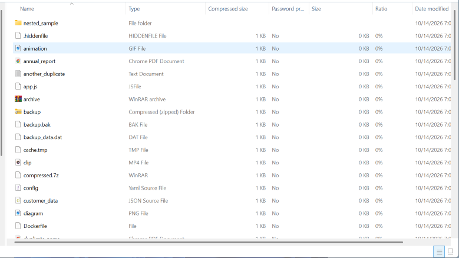
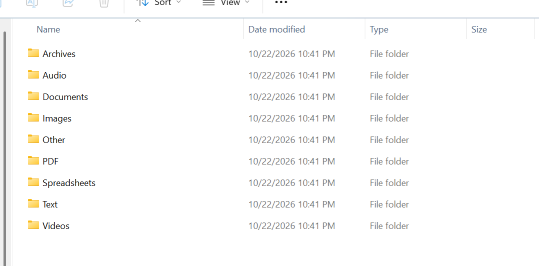

## The File organizer
### A Python automation tool for organizing messy directories.

## The purpose behind the project
### I once observed one of my project directories ended up messy by random files, And it appeared so ugly. And i decided to apply python file handling in order to get certain directory's files organized into separated file category.

## How it works
### The program requires file path to the directory that needs to be organized. It can also contain nested directories. It processes the directory against specified file categories and generates a new file hierarchy with directories dedicated to each file category. More importantly, the program replaces the files to directories with generic names (E.g.: Images, Documents)

## Input
### Example:
```bash
Give us directory path (absolute path): C:\Users\Ashiq\Desktop\messy_files_test_set
```


## Output
### The output directory will be created on the root of the source directory.


## Features
- Intellectual duplicate handling
- Manipulates unknown files

## Limitations
### The program uses following limited categorizations.
- PDF
- Documents
- Text
- Spreadsheets
- Images
- Audio
- Videos
- Archives

## Future improvement
- User configuration to add more file categories
- Feature that allows user to set output destination
- Operation result preview
- Handling inaccessible files
